<p align="center">
  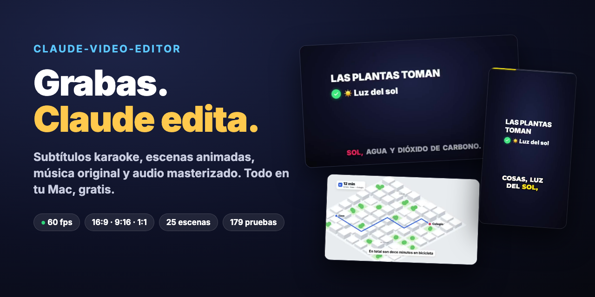
</p>

<p align="center">
  <a href="LICENSE"></a>
  
  
  
  <a href="https://www.remotion.dev"></a>
  <a href="https://claude.com/claude-code"></a>
</p>

<p align="center"><b>Español</b> · <a href="#english">English</a></p>

# claude-video-editor

**Editor de video automático para [Claude Code](https://claude.com/claude-code).** Grabas, pones el video en `videos/` y
le dices a Claude *"edítalo para TikTok"*. Él corta, subtitula, anima, pone música y te entrega el video listo, a 60 fps.
No necesitas saber editar: tú solo dices qué te gusta y qué no. Todo corre en tu computador, gratis.

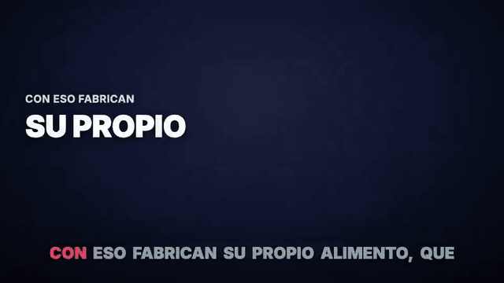

## ✨ Qué hace

| | |
|---|---|
| ✂️ **Edición** | Corta silencios, muletillas y frases repetidas · zooms que siguen la cara · gancho al inicio · varios clips en uno · editar borrando texto |
| 💬 **Subtítulos** | Palabra por palabra (karaoke), 5 estilos, máximo 2 líneas, sincronizados con la voz y siempre dentro de la zona segura |
| 🎬 **Animación** | 25 tipos de escenas (titulares, listas, gráficas, mapas, chat de IA, pantalla dividida…) · títulos **detrás de la cabeza** · b-roll · efectos 3D |
| 🔊 **Sonido** | Voz limpia · música original compuesta por el editor que baja sola cuando hablas · efectos alineados al cuadro · -14 LUFS |
| 🎨 **Tu marca** | Colores y fuentes desde tu página web · Brand Lab para escoger estilos · color automático (natural, cine, cálido, vivo) |
| ✅ **Revisión** | Storyboard Keep / Maybe / Drop · control de calidad automático (fps, volumen, parpadeos, sincronía) · portada y `.srt` |
| 📐 **Formatos** | TV / proyector 16:9 · TikTok / Reels 9:16 · cuadrado 1:1 · vertical 4:5 |

## 🚀 Empieza en 3 pasos

1. **Descarga** este repositorio (botón verde **Code → Download ZIP**, o `git clone`).
2. **Instala**: doble clic en **`instalar.command`** (una sola vez, ~1 GB: Node, Python con Whisper, ffmpeg y Remotion).
3. **Edita**: abre la carpeta con Claude Code, pon tu video en `videos/` y escribe:
   > *Edita videos/mi-video.mov para el colegio*

El video queda en `salida/` con su portada y sus subtítulos.

## ⚙️ Cómo funciona

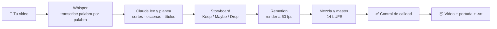

## 🖼️ Galería

| 16:9 (TV / proyector) | 9:16 (TikTok / Reels) |
|---|---|
| 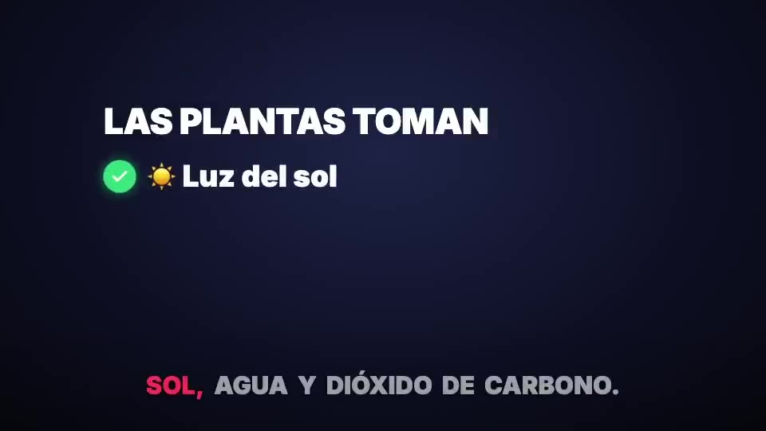 | 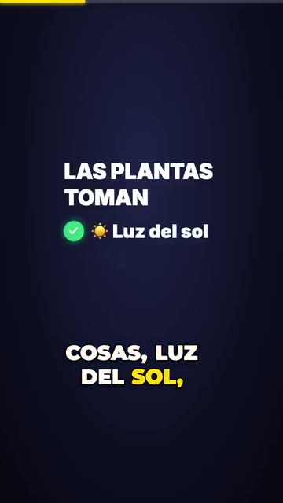 |

Estilo "reel de tutorial" (`demo/reel_extras.json`): pantalla dividida, subtítulos de una palabra, banner fijo y
llamada a la acción animada:

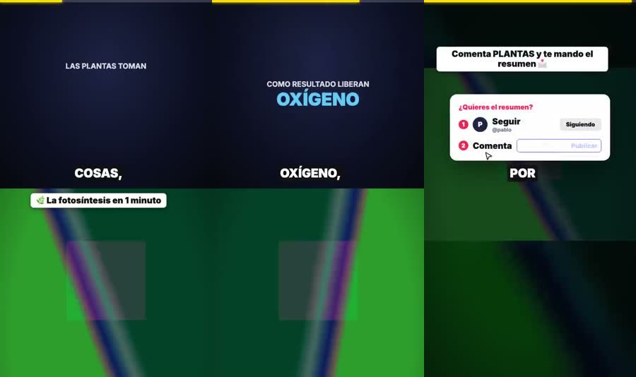

Animaciones explicativas desde cero (comandos `/palitos`, `/despiece`, `/minimalista`, `/mapa-ruta`, `/grafica` en
Claude Code, o `bash scripts/animar.sh receta.json`), con voz narrada, música y audio masterizado:

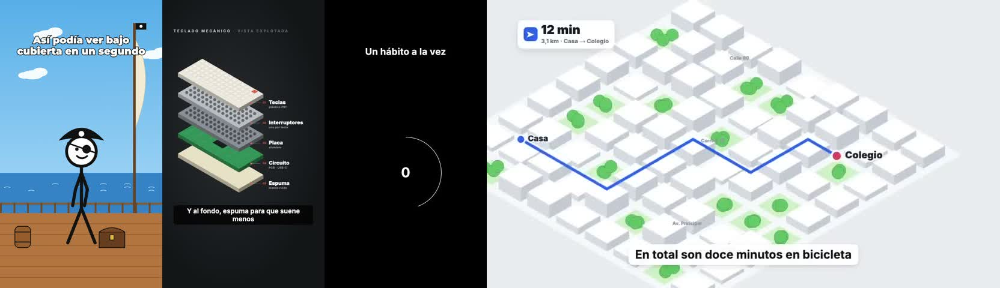

Brand Lab: muestras de estilo con tu marca para calificar (Keep / Maybe / Drop), igual que el storyboard de cada video:

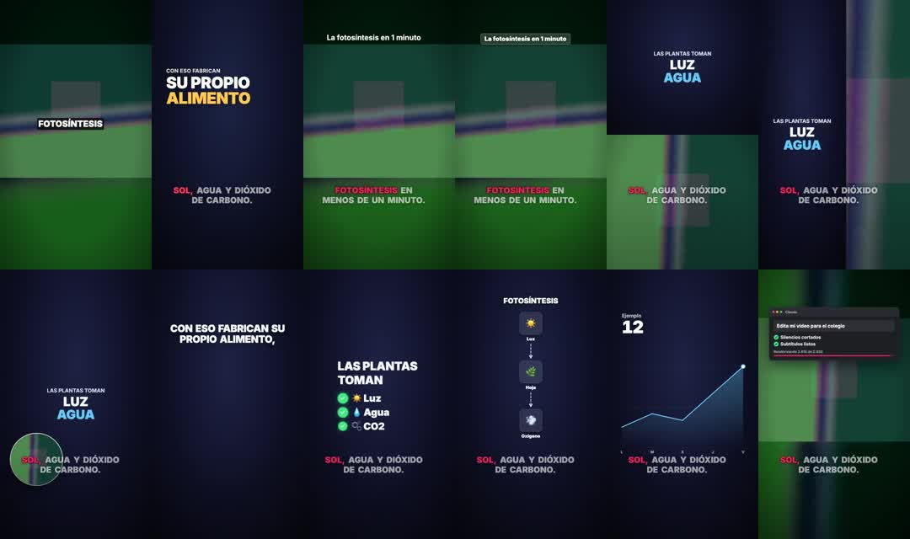

Estilos de subtítulos (`--subtitulos`):

| `cine` | `caja` | `tiktok` | `resaltado` |
|---|---|---|---|
| 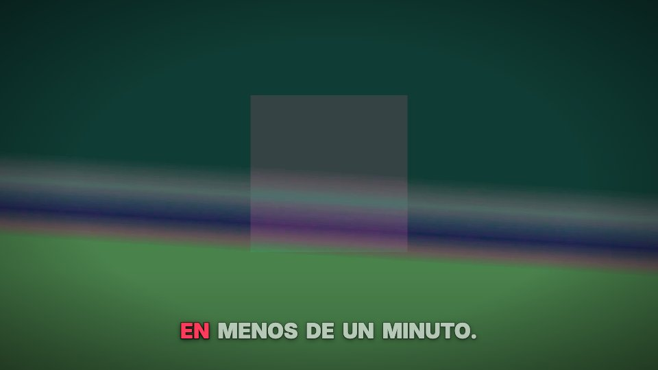 | 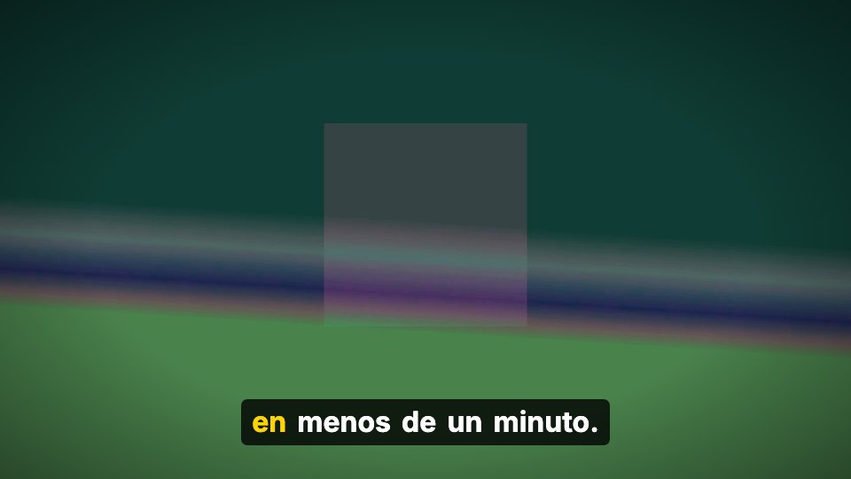 | 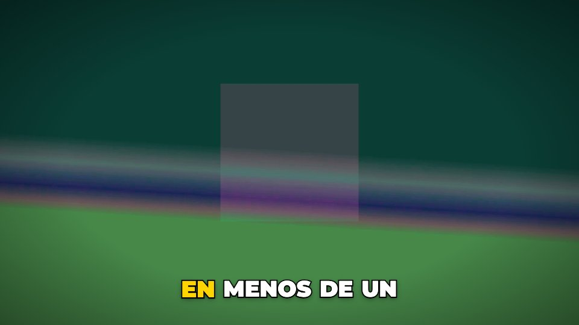 | 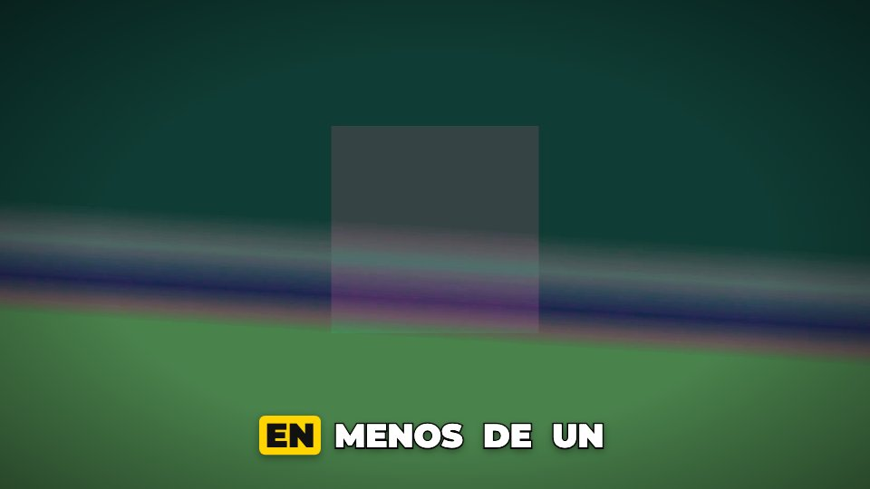 |

*(Todas las imágenes salieron del propio editor, a partir de un video de demostración sin personas: `demo/`.)*

## 📖 Uso en detalle
Con Claude Code: abre la carpeta y pídele *"Edita videos/mi-video.mov para el colegio"* o *"…para TikTok"*.
Claude sigue las reglas de [`CLAUDE.md`](CLAUDE.md) y aprende de tus correcciones en [`estilo.md`](estilo.md).
Para comprobar que todo quedó bien instalado: `npm test`.

Sin Claude, un solo comando:
```bash
bash scripts/editar.sh videos/mi-video.mov --preset colegio-tv
bash scripts/editar.sh videos/mi-video.mov --preset tiktok --extras trabajo/mi-video_extras.json
bash scripts/editar.sh videos/mi-video.mov --formato cuadrado --calidad preview
```

| Opción | Valores |
|---|---|
| `--preset` | `colegio-tv`, `tiktok`, `youtube`, `documental` |
| `--formato` | `tv` (16:9 1920x1080), `reel` (9:16 1080x1920), `cuadrado` (1:1 1080x1080), `retrato` (4:5 1080x1350) |
| `--calidad` | `preview` (media resolución, rápida), `final` (H.264 para TikTok/WhatsApp/proyectores), `maxima` |
| `--subtitulos` | `cine`, `caja`, `tiktok`, `resaltado`, `etiqueta` (una palabra a la vez) |
| `--solo-preparar` | transcribe y arma el plan sin renderizar (para revisar) |
| `--storyboard` | render rápido + página para calificar cada tramo: Keep / Maybe / Drop |

Más formas de trabajar:

| Quiero… | Comando |
|---|---|
| Revisar cada tramo antes del render final | `bash scripts/editar.sh … --storyboard` y `python scripts/storyboard.py servir X` |
| Editar borrando texto (como Descript) | `python scripts/guion.py exportar …` → borras frases → `guion.py aplicar …` |
| Sacar clips cortos de un video largo | `python scripts/clips.py trabajo/X_transcripcion.json` |
| Poner mi marca (colores y fuentes de mi web) | `python scripts/marca.py desde-web https://…` |
| Calificar 22 muestras de estilo (Brand Lab) | `python scripts/brand_lab.py` |
| Un efecto 3D (HyperFrames) | `bash scripts/hyperframes.sh tarjeta3d --formato reel` |
| Un sonido que me falta | `python scripts/generar_sonido.py swipe` |
| Unir varios clips | `bash scripts/editar.sh videos/a.mov videos/b.mov --preset tiktok` |
| Seguir en DaVinci o Premiere | `python scripts/exportar_edl.py trabajo/X_edit.json videos/X.mov` |

(`python` = `.venv/bin/python`.) Cómo se compara con otros editores: [COMPARACION.md](COMPARACION.md).

El resultado queda en `salida/` con su portada (`_portada.jpg`) y subtítulos (`.srt`).
Toda la configuración vive en [`editor.config.json`](editor.config.json). Ejemplo de extras: [`demo/fotosintesis_extras.json`](demo/fotosintesis_extras.json).

## 🛡️ Qué garantiza (y se comprueba solo)
- **60 fps** siempre; las animaciones están atadas al tiempo, así que se ven suaves aunque el video original sea de 30 fps
  (no se inventan cuadros de la imagen grabada).
- **Audio**: mezcla final masterizada a **-14 LUFS** con **pico real ≤ -1 dBTP**, medido en el archivo final.
  Voz con reducción de ruido, EQ suave y de-esser; música que baja sola cuando alguien habla.
- **Subtítulos**: karaoke palabra por palabra, máximo 2 líneas, nunca se corta una palabra (se mide con el ancho real de
  cada letra), siempre dentro de la zona segura del formato, letra ≥ 5,5 % del alto en TV, contraste ≥ 4,5:1.
- **Flujo**: caché por huella del video (no vuelve a transcribir lo mismo), render por partes que se **reanuda** si se
  interrumpe, reintento automático si Remotion se cuelga, mensajes de error en español con qué hacer.
- **Títulos detrás de la cabeza y fondo nuevo** sin pantalla verde (recorte de la persona con MODNet, local).
- **Revisión**: storyboard con Keep / Maybe / Drop, revisión de cada corte, música ≥ 12 dB debajo de la voz, cada efecto
  medido contra la voz, subtítulos medidos contra el audio (nunca se adelantan), escaneo de cuadros con fallas.
- `npm test`: tipos + 105 pruebas (vitest) + 74 pruebas (Python) = **179**: subtítulos, formatos, fps, duración, audio,
  sincronía, storyboard, marca, sonidos, clips, guion, animaciones.
  `npm run prueba:render`: edita el demo en 16:9 y 9:16 y pasa el control de calidad.

## 🗂️ Estructura
```
scripts/editor.py      el flujo completo (lo llama scripts/editar.sh)
scripts/plan_edit.py   cortes, subtítulos, escenas, capítulos -> public/edit.json
scripts/mezcla.py      mezcla de audio exacta; scripts/audio.py mide y masteriza
scripts/storyboard.py  página de revisión; brand_lab.py, marca.py, guion.py, clips.py, pantalla.py, recorte_persona.py…
brand/                 tu marca (colores, fuentes); hyperframes/  efectos en HTML
src/                   Remotion: Edit.tsx, Subtitulos.tsx, escenas/, subtitulos/, tiempo.ts, formatos.ts
pruebas/               pruebas automáticas
editor.config.json     presets, formatos, calidades, audio
docs/desarrollo/       notas del desarrollo: auditoría inicial, progreso por rondas, pendientes
```

## 📜 Licencias
- Código de este proyecto: [MIT](LICENSE).
- **Remotion** tiene licencia propia ([remotion.dev/license](https://www.remotion.dev/license)): **gratis** para personas,
  organizaciones sin ánimo de lucro y empresas con fines de lucro de hasta 3 empleados; empresas más grandes necesitan
  una licencia de pago. Para uso personal o de estudiante es gratis.
- Whisper (faster-whisper): MIT. ffmpeg: LGPL/GPL. Detector de caras UltraFace: MIT. Fuentes: SIL OFL 1.1
  (avisos y texto completo en `public/fuentes/LICENCIAS_FUENTES.txt`).
- HyperFrames (efectos): Apache 2.0; usa GSAP (gratis, licencia propia de GSAP) desde internet al renderizar un efecto.
  MODNet (recorte de personas): Apache 2.0, se descarga solo la primera vez (25 MB). yt-dlp: Unlicense.
- La música la compone el propio editor y los efectos son sintetizados: no tienen derechos de terceros.
- Resumen de todo lo de terceros: [AVISOS_TERCEROS.md](AVISOS_TERCEROS.md).

---

## English

**You record. Claude edits.** An automatic video editor driven by [Claude Code](https://claude.com/claude-code): drop a
clip in `videos/`, say *"edit it for TikTok"*, and get back a finished 60 fps video. Whisper transcription, silence and
retake removal, word-by-word karaoke captions, face-tracking punch-in zooms, hook titles, chapters, 25 animated
motion-graphics scenes, b-roll, auto color, original background music with ducking, and sound effects. Rendered with
[Remotion](https://www.remotion.dev). Runs locally on your Mac, free.

**Quick start (macOS):**
1. Download this repo (**Code → Download ZIP** or `git clone`).
2. Double-click `instalar.command` (portable Node, Python + Whisper + ffmpeg, Remotion; ~1 GB, once).
3. Open the folder in Claude Code, put your clip in `videos/` and ask *"Edit videos/my-video.mov for TikTok"*.

**Use:** ask Claude Code *"Edit videos/my-video.mov for TikTok"*, or run it yourself:
```bash
bash scripts/editar.sh videos/my-video.mov --preset colegio-tv   # 16:9 for TV/projector
bash scripts/editar.sh videos/my-video.mov --preset tiktok       # 9:16
```
Formats: `tv` 16:9, `reel` 9:16, `cuadrado` 1:1, `retrato` 4:5. Quality: `preview`, `final`, `maxima`.
Caption styles: `cine`, `caja` (boxed, best on projectors), `tiktok`, `resaltado` (highlight pill), `etiqueta` (one word
at a time). Scenes include split screen (stacked, side-by-side or face-in-circle), self-building charts, animated map
routes, a follow/comment call-to-action, pinned banners and profanity bleeping.
All settings live in `editor.config.json`. Interface and messages are in Spanish.

**Guarantees, checked automatically:** 60 fps output; final mix at -14 LUFS with true peak ≤ -1 dBTP measured on the
delivered file; captions max 2 lines, never split words, always inside each format's safe area, contrast ≥ 4.5:1;
content-hash cache (no re-transcribing), chunked renders that **resume** after interruption, automatic retry if a
render hangs. It also makes explainer animations from scratch (stick-figure cartoons, minimal graphics, exploded product views, 3D map
routes, self-building charts) with free macOS text-to-speech narration: `bash scripts/animar.sh recipe.json`.
New in 2.3: storyboard review page (Keep / Maybe / Drop per beat), brand sheet + Brand Lab, titles behind the head and
background replacement (local matting), cinematic screen recordings with auto-zoom, HyperFrames 3D effects, text-based
editing, long-to-short clip suggestions, EDL export, caption sync measured against the voice, per-effect loudness checks.
See [COMPARACION.md](COMPARACION.md) for an honest comparison with other editors.
`npm test` runs type checks plus 179 automated tests.

**Licenses:** project code is [MIT](LICENSE). **Remotion has its own license**: free for individuals, non-profits and
for-profit companies with up to 3 employees; larger companies need a paid company license. Whisper (MIT), ffmpeg
(LGPL/GPL), UltraFace (MIT), fonts (SIL OFL 1.1, see `public/fuentes/LICENCIAS_FUENTES.txt`). Music and SFX are generated by the editor itself.
Full list: [AVISOS_TERCEROS.md](AVISOS_TERCEROS.md).
