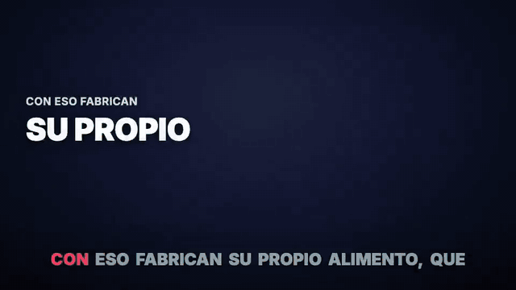
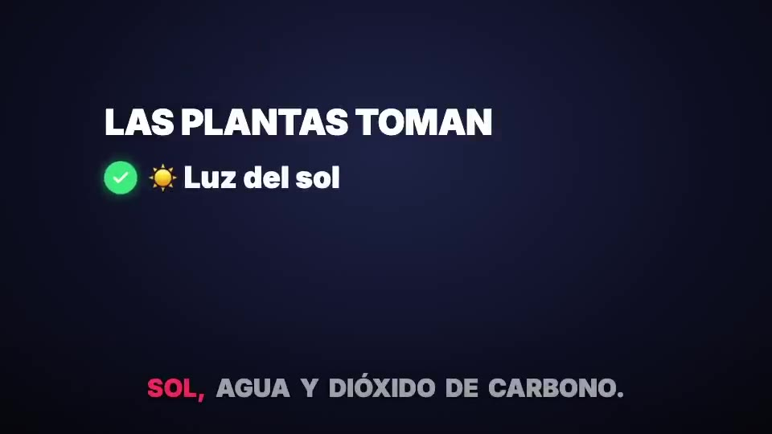
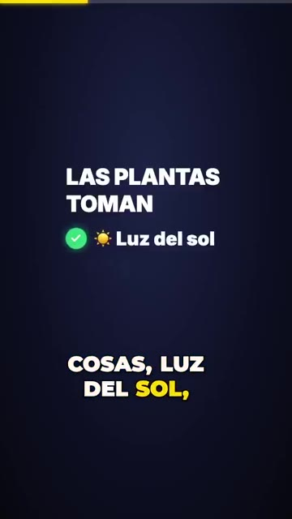
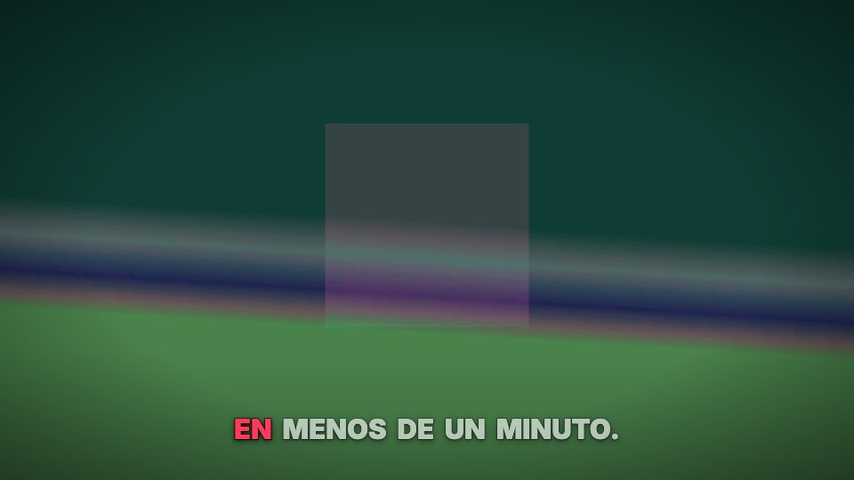
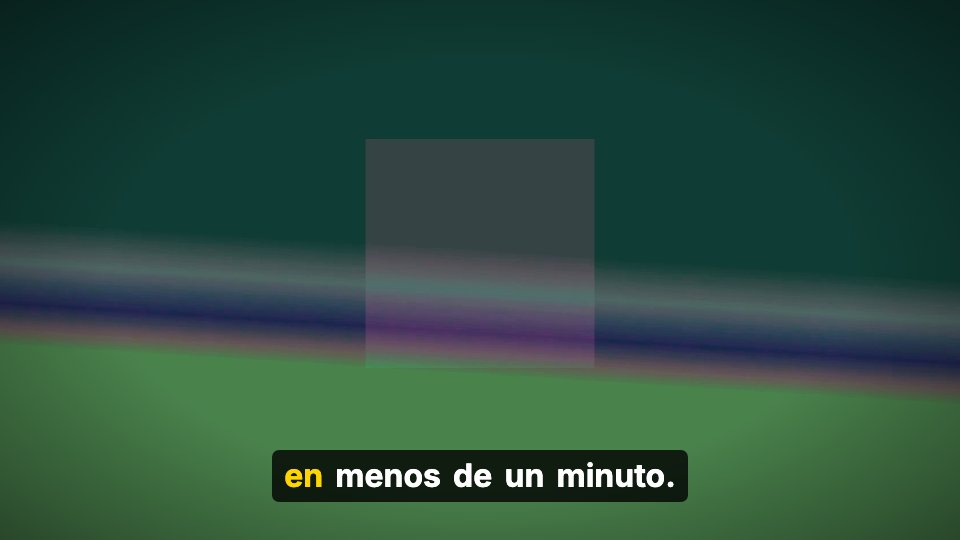
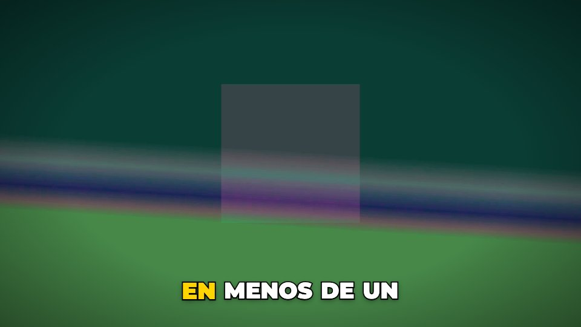
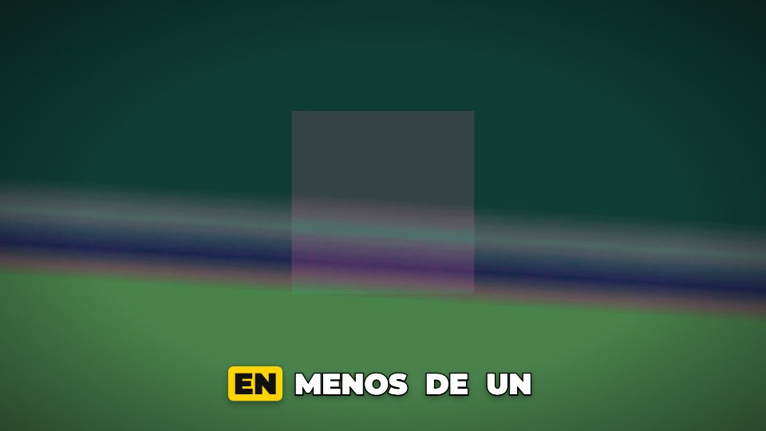

# claude-video-editor

**Español** · [English](#english)

Editor de video automático pensado para usarse con [Claude Code](https://claude.com/claude-code): grabas, pones el video en
`videos/`, y Claude lo edita. Transcribe con Whisper, corta silencios y repeticiones, pone subtítulos palabra por palabra,
zooms que siguen la cara, títulos, capítulos, escenas animadas, b-roll, color, música original con ducking y efectos de
sonido. Renderiza con [Remotion](https://www.remotion.dev) **a 60 fps**. Todo corre en tu computador, gratis.



| 16:9 (TV / proyector) | 9:16 (TikTok / Reels) |
|---|---|
|  |  |

Estilos de subtítulos (`--subtitulos`):

| `cine` | `caja` | `tiktok` | `resaltado` |
|---|---|---|---|
|  |  |  |  |

*(Todas las imágenes salieron del propio editor, a partir de un video de demostración sin personas: `demo/`.)*

## Instalación (macOS)
1. Descarga o clona este repositorio.
2. Doble clic en **`instalar.command`** (instala Node portátil, Python con Whisper y ffmpeg, y Remotion; ~1 GB, una vez).
   Desde la terminal es lo mismo: `bash instalar.command`.
3. Comprueba: `npm test`.

## Uso
Con Claude Code: abre la carpeta y pídele *"Edita videos/mi-video.mov para el colegio"* o *"…para TikTok"*.
Claude sigue las reglas de [`CLAUDE.md`](CLAUDE.md) y aprende de tus correcciones en [`estilo.md`](estilo.md).

Sin Claude, un solo comando:
```bash
bash scripts/editar.sh videos/mi-video.mov --preset colegio-tv
bash scripts/editar.sh videos/mi-video.mov --preset tiktok --extras trabajo/mi-video_extras.json
bash scripts/editar.sh videos/mi-video.mov --formato cuadrado --calidad preview
```

| Opción | Valores |
|---|---|
| `--preset` | `colegio-tv`, `tiktok`, `youtube`, `documental` |
| `--formato` | `tv` (16:9 1920x1080), `reel` (9:16 1080x1920), `cuadrado` (1:1 1080x1080), `retrato` (4:5 1080x1350) |
| `--calidad` | `preview` (media resolución, rápida), `final` (H.264 para TikTok/WhatsApp/proyectores), `maxima` |
| `--subtitulos` | `cine`, `caja`, `tiktok`, `resaltado` |
| `--solo-preparar` | transcribe y arma el plan sin renderizar (para revisar) |

El resultado queda en `salida/` con su portada (`_portada.jpg`) y subtítulos (`.srt`).
Toda la configuración vive en [`editor.config.json`](editor.config.json). Ejemplo de extras: [`demo/fotosintesis_extras.json`](demo/fotosintesis_extras.json).

## Qué garantiza (y se comprueba solo)
- **60 fps** siempre; las animaciones están atadas al tiempo, así que se ven suaves aunque el video original sea de 30 fps
  (no se inventan cuadros de la imagen grabada).
- **Audio**: mezcla final masterizada a **-14 LUFS** con **pico real ≤ -1 dBTP**, medido en el archivo final.
  Voz con reducción de ruido, EQ suave y de-esser; música que baja sola cuando alguien habla.
- **Subtítulos**: karaoke palabra por palabra, máximo 2 líneas, nunca se corta una palabra (se mide con el ancho real de
  cada letra), siempre dentro de la zona segura del formato, letra ≥ 5,5 % del alto en TV, contraste ≥ 4,5:1.
- **Flujo**: caché por huella del video (no vuelve a transcribir lo mismo), render por partes que se **reanuda** si se
  interrumpe, reintento automático si Remotion se cuelga, mensajes de error en español con qué hacer.
- `npm test`: tipos + 63 pruebas de subtítulos/animación (vitest) + 31 pruebas de formatos, plan, fps, duración, audio y memoria (Python).
  `npm run prueba:render`: edita el demo en 16:9 y 9:16 y pasa el control de calidad.

## Estructura
```
scripts/editor.py      el flujo completo (lo llama scripts/editar.sh)
scripts/plan_edit.py   cortes, subtítulos, escenas, capítulos -> public/edit.json
scripts/mezcla.py      mezcla de audio exacta; scripts/audio.py mide y masteriza
src/                   Remotion: Edit.tsx, Subtitulos.tsx, escenas/, subtitulos/, tiempo.ts, formatos.ts
pruebas/               pruebas automáticas
editor.config.json     presets, formatos, calidades, audio
```

## Licencias
- Código de este proyecto: [MIT](LICENSE).
- **Remotion** tiene licencia propia ([remotion.dev/license](https://www.remotion.dev/license)): **gratis** para personas,
  organizaciones sin ánimo de lucro y empresas con fines de lucro de hasta 3 empleados; empresas más grandes necesitan
  una licencia de pago. Para uso personal o de estudiante es gratis.
- Whisper (faster-whisper): MIT. ffmpeg: LGPL/GPL. Detector de caras UltraFace: MIT. Fuentes: SIL OFL 1.1 (avisos y licencia completa en `public/fuentes/LICENCIAS_FUENTES.txt`).
- La música la compone el propio editor y los efectos son sintetizados: no tienen derechos de terceros.

---

## English

Automatic video editor designed to be driven by [Claude Code](https://claude.com/claude-code): record, drop the file in
`videos/`, and Claude edits it. Whisper transcription, silence and retake removal, word-by-word karaoke captions,
face-tracking punch-in zooms, hook titles, chapters, animated motion-graphics scenes, b-roll, auto color, original
background music with ducking, and sound effects. Rendered with [Remotion](https://www.remotion.dev) at **60 fps**.
Runs locally, free.

**Install (macOS):** double-click `instalar.command` (portable Node, Python + Whisper + ffmpeg, Remotion; ~1 GB once),
then run `npm test`.

**Use:** ask Claude Code *"Edit videos/my-video.mov for TikTok"*, or run it yourself:
```bash
bash scripts/editar.sh videos/my-video.mov --preset colegio-tv   # 16:9 for TV/projector
bash scripts/editar.sh videos/my-video.mov --preset tiktok       # 9:16
```
Formats: `tv` 16:9, `reel` 9:16, `cuadrado` 1:1, `retrato` 4:5. Quality: `preview`, `final`, `maxima`.
Caption styles: `cine`, `caja` (boxed, best on projectors), `tiktok`, `resaltado` (highlight pill).
All settings live in `editor.config.json`. Interface and messages are in Spanish.

**Guarantees, checked automatically:** 60 fps output; final mix at -14 LUFS with true peak ≤ -1 dBTP measured on the
delivered file; captions max 2 lines, never split words, always inside each format's safe area, contrast ≥ 4.5:1;
content-hash cache (no re-transcribing), chunked renders that **resume** after interruption, automatic retry if a
render hangs. `npm test` runs type checks plus 94 automated tests.

**Licenses:** project code is [MIT](LICENSE). **Remotion has its own license**: free for individuals, non-profits and
for-profit companies with up to 3 employees; larger companies need a paid company license. Whisper (MIT), ffmpeg
(LGPL/GPL), UltraFace (MIT), fonts (SIL OFL 1.1, see `public/fuentes/LICENCIAS_FUENTES.txt`). Music and SFX are generated by the editor itself.
